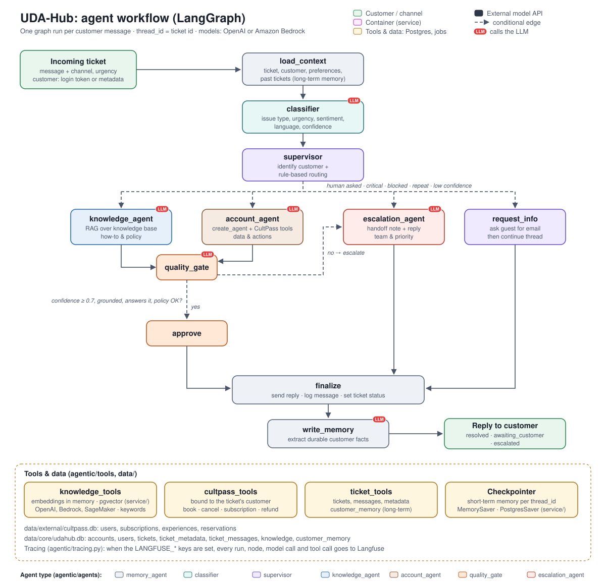
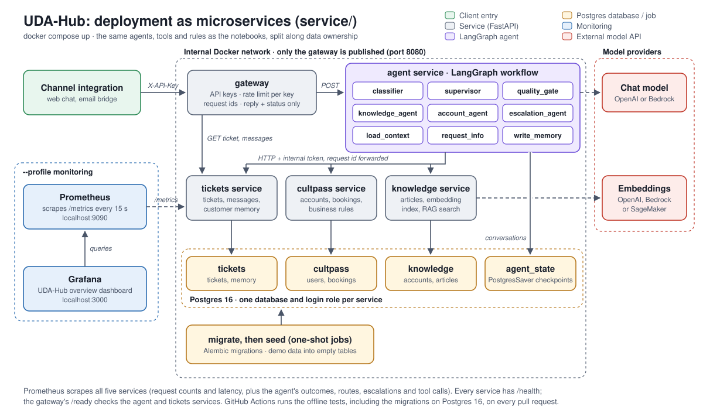

# UDA-Hub: Multi-Agent Customer Support with LangGraph

> **Amazon Bedrock port.** This repository adds Amazon Bedrock as a model provider to
> [uda-hub-multi-agent-support](https://github.com/manish5593/uda-hub-multi-agent-support). Set
> `UDAHUB_LLM_PROVIDER=bedrock` to use Claude through the Bedrock Converse API, with Titan Text Embeddings V2 for
> retrieval. Retrieval embeddings can instead come from an Amazon SageMaker endpoint
> ([below](#sagemaker-embeddings)). **Status:** both are implemented and covered by the offline tests, but the system
> has not yet been run against Bedrock or SageMaker. The demo results below are from the original OpenAI
> (`gpt-4o-mini`) version.

UDA-Hub is an intelligent, multi-agent decision suite that resolves customer support tickets for the
platforms it serves. It is built with LangGraph. The first integrated account is **CultPass**, a
subscription for cultural experiences.

## Architecture

Two diagrams describe the system, and both use the node names from the code
([`solution/agentic/workflow.py`](solution/agentic/workflow.py)):

1. **The agent workflow**: what happens to one customer message.
2. **The deployment**: where that workflow runs when it is deployed as microservices.

Both use the same colours. Each node is coloured by its agent type, the module in `agentic/agents` it comes from: gray `memory_agent`
(`load_context`, `finalize`, `write_memory`), teal `classifier`, purple `supervisor` (`supervisor`,
`request_info`), blue `knowledge_agent`, brown `account_agent`, orange `quality_gate` (`quality_gate`, `approve`)
and red `escalation_agent`. A red **LLM** badge marks every node that calls the model; it is not a colour. Green is
the customer, yellow is tools and data, and dashed arrows are conditional routes. The deployment adds magenta for
the containers (gateway, services, monitoring) and dark slate for the external model APIs.

### 1. The agent workflow



A ticket in natural language, plus optional metadata (customer, channel, urgency), goes through these nodes:

| Node | Uses the LLM | What it does |
|---|---|---|
| `load_context` | No | Finds or creates the ticket, identifies the customer, and recalls long-term memory |
| `classifier` | Yes | Issue type, urgency, sentiment, language and confidence |
| `supervisor` | No | Identifies the customer and routes the ticket with auditable rules. Human requests, legal or critical issues, blocked accounts and repeat problems go straight to `escalation_agent` |
| `knowledge_agent` | Yes | Answers from the knowledge base with RAG |
| `account_agent` | Yes | Uses CultPass tools (reservations, subscription, refund requests) scoped to the customer, which only accept ids it looked up |
| `request_info` | Only to translate | Asks a guest for their email when an account action is needed |
| `quality_gate` | Yes | Checks the draft's confidence and grounding; code then sends it (`approve`) or escalates it |
| `escalation_agent` | Yes | Hands off to the right human team with a summary |
| `finalize` | No | Sends the reply and sets the ticket's status |
| `write_memory` | Yes | Saves lasting facts from the customer's own messages, with filters that keep stale, one-off and personal details out |

Short-term memory is the conversation per ticket (the LangGraph checkpointer). Long-term memory is the customer's
preferences, reported issues and past tickets, in `udahub.db`.

Business rules and policies are enforced in code, not left to prompts: the LLM proposes, and code decides. See
[Safeguards](solution/agentic/design/README.md#safeguards-the-llm-proposes-code-decides).

### 2. The deployment

The same workflow, with the same nodes, prompts, tools and rules, runs in two ways:

- **In process**, from the notebooks or `process_ticket()`, against the committed SQLite databases (`solution/`).
- **As microservices** behind an API gateway, run with Docker Compose ([`service/`](service/README.md)). The
  whole workflow runs inside the agent service; the tickets, cultpass and knowledge services only hold data, each
  in its own Postgres database. Prometheus and Grafana show traffic and support outcomes.



An evaluation suite ([`solution/evals/`](solution/evals/README.md)) runs 36 labelled tickets against the real model
and reports routing, outcome, tool and answer accuracy. GitHub Actions runs the offline tests on every pull
request.

## Repository layout

| Path | Contents |
|---|---|
| `solution/` | The complete, working project, with its own guide in [`solution/README.md`](solution/README.md) |
| `service/` | The same system as microservices (gateway, agent, CultPass, tickets, knowledge) with Postgres and Docker Compose, in [`service/README.md`](service/README.md) |
| `requirements.txt` | Python dependencies |
| `.github/workflows/tests.yml` | CI: runs the solution and service tests (with a Postgres 16 service) on pushes to `main` and on pull requests |

```
solution/
├── 01_external_db_setup.ipynb   # rebuilds data/external/cultpass.db
├── 02_core_db_setup.ipynb       # rebuilds data/core/udahub.db
├── 03_agentic_app.ipynb         # demo scenarios (committed with outputs) and interactive chat
├── agentic/
│   ├── workflow.py              # LangGraph graph: `orchestrator`, `process_ticket()`
│   ├── agents/                  # classifier, supervisor, knowledge_agent, account_agent, quality_gate, escalation_agent, memory
│   ├── tools/                   # CultPass tools, RAG retriever, ticket and memory storage
│   ├── remote/                  # HTTP clients the tools use when running as microservices (service/)
│   ├── design/                  # architecture diagram, Mermaid graph and design document
│   ├── config.py                # model providers, models, paths and thresholds
│   ├── llm.py                   # chat and embedding models for OpenAI, Bedrock or SageMaker
│   └── state.py                 # graph state and structured-output schemas
├── data/                        # SQLAlchemy models, JSONL seed data and the SQLite databases
├── deploy/                      # deploy and delete the SageMaker embedding endpoint
├── evals/                       # evaluation suite: labelled tickets run against the real model
└── tests/                       # offline unit and end-to-end tests
```

### Documentation

| README | What it covers |
|---|---|
| [`report.md`](report.md) | Project report: architecture, results, the problems found in real-model testing and how each was fixed, lessons, and limitations |
| [`solution/README.md`](solution/README.md) | Project guide: ticket flow, demo results, and where each requirement is met |
| [`service/README.md`](service/README.md) | Microservices: architecture, how the split works, running with Docker Compose, monitoring with Grafana, schema migrations, the public API, and limitations |
| [`evals/`](solution/evals/README.md) | Evaluation suite: running it, what is checked, and the case format |
| [`agentic/design/`](solution/agentic/design/README.md) | Architecture, routing rules, resolve-or-escalate logic, memory, and safeguards |
| [`agentic/agents/`](solution/agentic/agents/README.md) | Each agent node, the long-term memory rules, and how to add an agent |
| [`agentic/tools/`](solution/agentic/tools/README.md) | Each tool and the rules it enforces, retrieval, and how to add a tool |
| [`data/core/`](solution/data/core/README.md) | `udahub.db`: tables, committed contents, and how the agents write to it |
| [`data/external/`](solution/data/external/README.md) | `cultpass.db`: demo customers, resetting, and adding data |

## Getting Started

### Dependencies

Python 3.11+ (tested with 3.11) and access to a model: an OpenAI API key, or Amazon Bedrock (AWS credentials,
with the Claude and Titan embedding models enabled). Python packages are listed in `requirements.txt`: LangGraph,
LangChain, langchain-openai, langchain-aws and boto3, NumPy (needed for embedding search), SQLAlchemy,
python-dotenv and pytest. The microservices also need Docker with Compose v2; their packages are pinned in
`service/requirements.txt`.

### Installation

```bash
python -m venv .venv && source .venv/bin/activate
pip install -r requirements.txt
cd solution
cp .env.example .env          # then add your OPENAI_API_KEY (and OPENAI_BASE_URL if using Vocareum)
```

Put your key in `.env`, which git ignores, and never in `.env.example`, which is committed.

Both databases are committed, so you can open `03_agentic_app.ipynb` straight away. It runs 13 demo scenarios and
then an interactive chat. The other two notebooks rebuild the databases, so run them only to reset the data:
the demos make real bookings and cancellations, and store tickets and memories.

1. `01_external_db_setup.ipynb` rebuilds `data/external/cultpass.db` (customers, subscriptions, experiences, reservations)
2. `02_core_db_setup.ipynb` rebuilds `data/core/udahub.db` (account, 18 knowledge articles, tickets, demo history and memory)

Programmatic use (from `solution/`):

```python
from agentic.workflow import orchestrator, process_ticket
state = process_ticket("I'd like to cancel my reservation", "T-1", {"email": "cathy.bloom@florals.org"})
print(state["final_response"])
```

### SageMaker embeddings

Knowledge-base retrieval can use embeddings from an Amazon SageMaker endpoint, while the agents keep using OpenAI
or Bedrock for chat. `solution/deploy/sagemaker_embeddings.py` deploys `BAAI/bge-small-en-v1.5` with Hugging Face
Text Embeddings Inference on an `ml.m5.xlarge` CPU instance, using boto3 only. You need an IAM role that SageMaker
can assume (with the `AmazonSageMakerFullAccess` policy, or one that allows pulling the image and writing logs).

From `solution/`:

```bash
python -m deploy.sagemaker_embeddings deploy --role-arn arn:aws:iam::<account-id>:role/<role>   # 5-10 minutes
python -m deploy.sagemaker_embeddings test     # embeds three sentences and prints their similarities
```

Then add `UDAHUB_EMBEDDING_PROVIDER=sagemaker` to `.env`. The 0.30 relevance threshold
(`UDAHUB_RAG_MIN_SCORE`) was tuned for OpenAI embeddings, so check it against the retrieval cells in notebook 03.

A real-time endpoint is billed for every hour it exists, whether or not it is used. Delete it when you're done:

```bash
python -m deploy.sagemaker_embeddings delete
```

## Testing

From `solution/`:

```bash
python -m pytest tests
```

The tests need no API key. Each one runs against a temporary copy of the databases, so your data is not modified.

The microservices have their own tests, run from the repository root with both requirements files installed.
Their migration tests also run against Postgres when `UDAHUB_TEST_POSTGRES_URL` is set (see
[`service/README.md`](service/README.md#tests)):

```bash
python -m pytest service/tests
```

GitHub Actions runs both suites, with a Postgres 16 service, on every pull request and every push to `main`.

To measure the real model, run the evaluation suite (needs the model settings in `.env`): 36 labelled tickets,
3 runs each, scored in code and by an LLM judge. See [`solution/evals/README.md`](solution/evals/README.md).

```bash
python -m evals.run
```

### Break Down Tests

- `tests/test_tools.py` covers the deterministic building blocks:
  - CultPass tool business rules: blocked accounts, inactive subscriptions, double booking, ownership checks, quota and subscription state transitions
  - account tools that are bound to one customer, and that refuse reservation or experience ids not looked up in the same turn
  - ticket creation and linking, metadata and long-term memory
  - the memory filters, which drop reservation state, named experiences, one-off requests and contact details, and the duplicate check, which ignores case and punctuation
  - the repeat-issue rule, which escalates repeated problems but not routine requests
  - keyword retrieval quality
  - every routing rule and escalation rule
- `tests/test_workflow.py` runs the whole LangGraph workflow end to end with a scripted fake LLM:
  - a RAG resolution
  - a low-confidence answer that gets escalated
  - a blocked customer who is escalated straight away
  - a multi-turn guest who is identified by email, with short-term and long-term memory recall
  - a refund request that forces escalation and stores a new memory
  - a memory about reservation state that is filtered out before it reaches the database
  - a memory writer that only sees the customer's messages, never the assistant's replies
  - a structured event for every agent decision, routing choice and tool call, searchable by any field
  - an LLM outage or unknown account that returns a fallback reply and flags the ticket instead of crashing
  - an empty message that is answered without calling the LLM
  - a repeat issue, from a previous ticket and from earlier on the same ticket, that goes straight to a human
  - the real `create_agent` loop with a scripted tool-calling model: a real tool call, and the step limit
- `tests/test_evals.py` checks the evaluation suite itself: the case file, every check, judge errors, fresh
  databases per run, errored runs, the model check, the report and `--fail-under`
- `service/tests/` covers the microservices in one process: the service APIs, internal-token and API-key checks,
  rate limiting, the full gateway → agent → services flow, the agent metrics, a service outage mid-turn, and the
  Alembic migrations (that they match the models, downgrade cleanly, and adopt databases created before them)

## Demo Results

These are the results of running the 13 scenarios in `03_agentic_app.ipynb` against the real model (`gpt-4o-mini`
with `text-embedding-3-small` for retrieval). The executed notebook, with every decision trace and reply, is
committed in `solution/`.

| # | Ticket | Route and tools | Outcome | Long-term memory |
|---|---|---|---|---|
| 1 | Guest asks what a subscription includes and whether premium events cost extra | classifier → knowledge agent (top article scored 0.78) | Resolved with an answer grounded in the subscription and tiers articles | None (guest) |
| 2 | Cathy asks about her reservations, then says "cancel that one" | account agent: `get_my_reservations`, then `cancel_my_reservation` | Resolved. The follow-up relied on short-term memory, and the reservation was cancelled with the credit returned | Cancellation memory dropped by the filter |
| 3 | Guest asks to book Samba Night, then gives their email | request_info → customer identified → account agent: `find_experiences`, `book_experience` | Resolved. Bob already had that booking, and the tool refused a duplicate | None (no duplicate of his stored preference) |
| 4 | Alice, whose account is blocked, can't log in | supervisor → escalation agent | Escalated to Trust & Safety (high priority) without revealing the reason for the block | Login issue recorded |
| 5 | Frank was charged twice | account agent: `request_refund` | Escalated to billing for support-lead approval, with no refund amount or timeline promised | Double charge and refund request recorded |
| 6 | Bob still can't log in after a password reset | supervisor → escalation agent (repeat issue: his previous ticket was a login problem) | Escalated to technical support | Login issue recorded |
| 7 | Bob asks for a recommendation | account agent: `find_experiences` | Suggested real upcoming Rio experiences that match his stored music and dance preference and his premium tier, skipping Samba Night, which he already booked | None |
| 8 | Cathy demands a real person | supervisor → escalation agent | Escalated immediately | None (one-off request) |
| 9 | Guest says the app keeps crashing | knowledge agent (top article: App Crashes and Technical Problems, 0.55) | Answered with the article's steps; waits for the customer to try them | None (guest) |
| 10 | Guest asks about a student discount | knowledge agent: no article above the 0.30 threshold | Escalated: "no relevant knowledge base article found" | None (guest) |
| 11 | Guest asks about parking at venues | knowledge agent: only related articles (QR codes, 0.41) | Escalated: the quality gate found the articles don't answer the question | None (guest) |
| 12 | Frank says he loves outdoor activities | account agent: `find_experiences` | Answered, and the preference was stored in long-term memory | "Likes outdoor activities and nature" |
| 13 | Frank asks for recommendations, in a new session | account agent, with the preference recalled from `udahub.db` | Suggested outdoor experiences from the catalog | None (already known) |

The safeguards each did their job during the run:

- **Knowledge grounding:** a cell in the notebook shows the right article retrieved for six kinds of ticket, and none for questions the knowledge base doesn't cover. Scenarios 10 and 11 show the two ways a question without a supporting article is escalated, instead of being answered with advice the articles don't contain.
- **Id guard:** in most of our runs of scenario 2, the agent first tried to cancel with an id it guessed. The tool refused it, and the agent looked the reservation up before cancelling. In other runs, including the committed one, the agent looked it up first. Either way the outcome is the same, and `test_account_tools_refuse_ids_not_looked_up` checks the guard directly.
- **Policy escalation:** refunds and blocked accounts always reached a human, whatever the model drafted.
- **Repeat issues:** in scenario 6 Bob's previous ticket was a login problem, so the supervisor escalated him straight away. This took the same route in 4 out of 4 runs.
- **Memory hygiene:** memories are third-person summaries of what the customer wrote, never the assistant's replies. Reservation state, named experiences, one-off requests, contact details and duplicates are not stored.

The model's wording varies from run to run, but the routes and outcomes above were the same across repeated runs.

## Project Instructions

| Deliverable | Where |
|---|---|
| Multi-agent architecture (supervisor, classifier, knowledge_agent, account_agent, escalation_agent) | [`solution/agentic/agents/`](solution/agentic/agents/), [`solution/agentic/workflow.py`](solution/agentic/workflow.py) |
| Architecture design | [`solution/agentic/design/README.md`](solution/agentic/design/README.md) |
| Input handling (text + metadata) | `process_ticket()` in [`workflow.py`](solution/agentic/workflow.py), `load_context` in [`memory_agent.py`](solution/agentic/agents/memory_agent.py) |
| Routing, RAG, resolve or escalate | [`supervisor.py`](solution/agentic/agents/supervisor.py), [`knowledge_agent.py`](solution/agentic/agents/knowledge_agent.py), [`quality_gate.py`](solution/agentic/agents/quality_gate.py). Notebook 03 also shows the routing rules on 10 sample tickets. |
| Tools (incl. internal refund tool) | [`solution/agentic/tools/`](solution/agentic/tools/). Notebook 03 also calls each tool on sample operations, including its error cases. |
| Memory (state, short-term, long-term) | [`memory_agent.py`](solution/agentic/agents/memory_agent.py), [`ticket_tools.py`](solution/agentic/tools/ticket_tools.py), `CustomerMemory` in [`udahub.py`](solution/data/models/udahub.py). Notebook 03 shows a returning customer's stored history, a fresh session picking up a ticket from the database, inspecting a ticket by `thread_id`, and a preference learned in one session and used in another (scenarios 12 and 13). |
| Knowledge base (≥ 14 articles) | [`cultpass_articles.jsonl`](solution/data/external/cultpass_articles.jsonl) (18) |
| Demo (committed with outputs) | [`03_agentic_app.ipynb`](solution/03_agentic_app.ipynb) |
| Structured, searchable logs | [`event_log.py`](solution/agentic/event_log.py) writes every decision to `logs/events.jsonl`. Notebook 03 searches it, and the [Logging](solution/agentic/design/README.md#logging) section lists the fields. |
| Error handling and edge cases | `process_ticket()` in [`workflow.py`](solution/agentic/workflow.py). Notebook 03's "Edge cases" cell covers an empty message, gibberish, an unknown customer, an unknown account and an LLM outage. |
| Safeguards enforced in code | [Safeguards](solution/agentic/design/README.md#safeguards-the-llm-proposes-code-decides) |
| Evaluation over repeated runs | [`solution/evals/`](solution/evals/README.md): 36 labelled tickets, scored in code and by an LLM judge |
| Deployment as microservices | [`service/`](service/README.md): an API gateway and four services, Postgres, Alembic migrations, Docker Compose, Prometheus and Grafana |

## Built With

* [LangGraph](https://langchain-ai.github.io/langgraph/) - Agent orchestration, state and checkpointing
* [LangChain](https://python.langchain.com/) - Tools, vector store and model integrations
* [OpenAI](https://platform.openai.com/) - `gpt-4o-mini` chat model and `text-embedding-3-small` embeddings
* [Amazon Bedrock](https://aws.amazon.com/bedrock/) and [Amazon SageMaker](https://aws.amazon.com/sagemaker/) - Claude and Titan embeddings, or an embedding endpoint
* [SQLAlchemy](https://www.sqlalchemy.org/) - Core (`udahub.db`) and external (`cultpass.db`) databases
* [NumPy](https://numpy.org/) - Cosine similarity for embedding search
* [FastAPI](https://fastapi.tiangolo.com/) - The gateway and the four services
* [PostgreSQL](https://www.postgresql.org/) and [Alembic](https://alembic.sqlalchemy.org/) - Service databases, LangGraph checkpoints and schema migrations
* [Docker Compose](https://docs.docker.com/compose/) - Running the services together
* [Prometheus](https://prometheus.io/) and [Grafana](https://grafana.com/) - Metrics and the UDA-Hub dashboard
* [GitHub Actions](https://docs.github.com/actions) - Continuous integration
