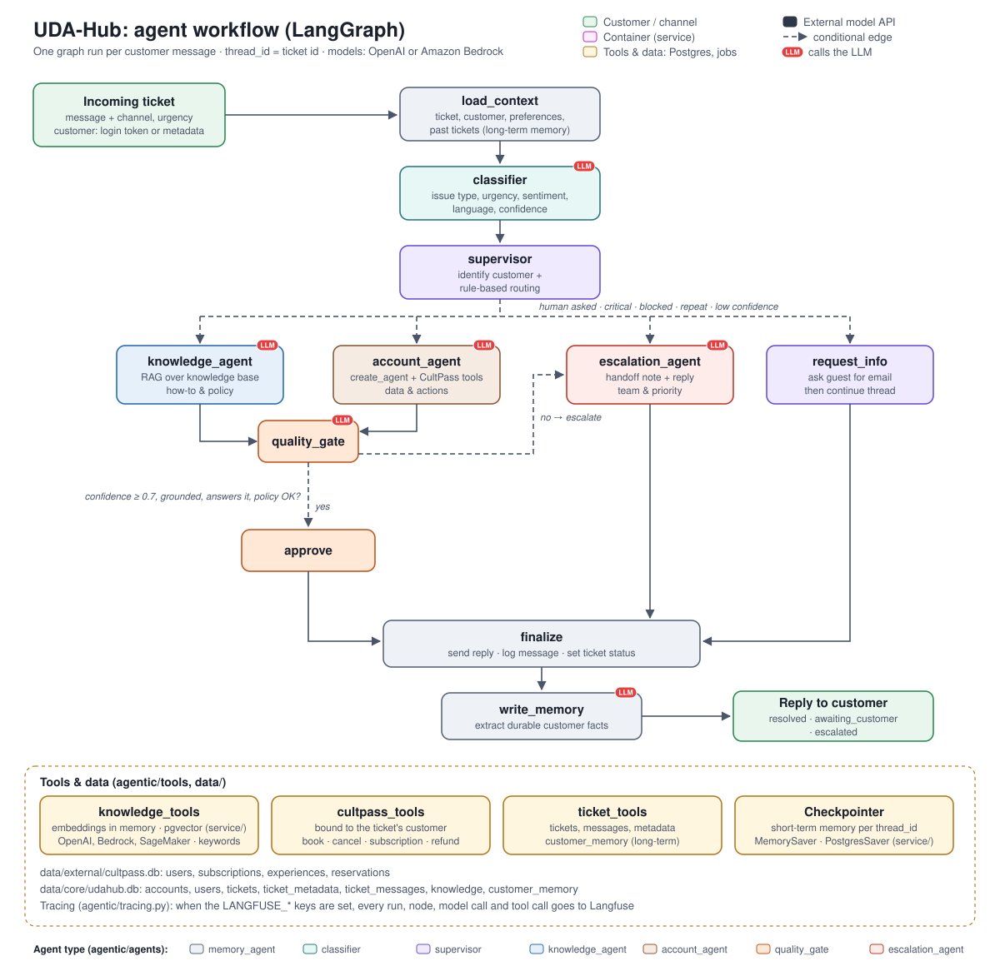
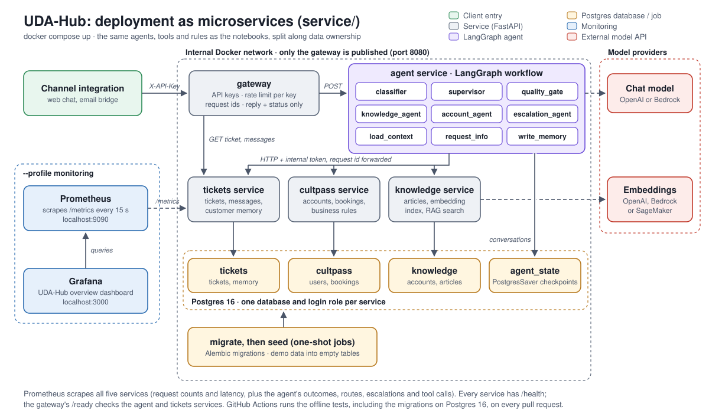

# Project Report: UDA-Hub Multi-Agent Customer Support

## 1. Summary

UDA-Hub resolves customer support tickets for CultPass, a subscription service for cultural experiences. A ticket
arrives as a natural-language message with optional metadata (customer, channel, urgency). The system classifies
it, routes it to a specialist agent, and either resolves it or escalates it to the right human team. It
answers from a knowledge base, acts on the customer's account through tools, and remembers the customer across
sessions.

| | |
|---|---|
| **Architecture** | Supervisor pattern in LangGraph: 7 agents in one `StateGraph` (11 nodes, 16 edges) |
| **Models** | `gpt-4o-mini` for every agent and `text-embedding-3-small` for retrieval (the demo run). Claude on Amazon Bedrock, Titan embeddings and a SageMaker embedding endpoint are implemented as alternatives, but not yet run |
| **Data** | Two SQLite databases: `cultpass.db` (customers, subscriptions, experiences, reservations) and `udahub.db` (tickets, messages, 18 knowledge articles, long-term memory). As microservices, the same tables in Postgres, one database per service |
| **Deployment** | `service/`: an API gateway and five services (agent, CultPass, tickets, knowledge, auth) with Postgres, Alembic migrations, Docker Compose, customer sign-up and login with JWTs, Prometheus with a Grafana dashboard, and optional Langfuse tracing (section 4) |
| **Demonstration** | `solution/03_agentic_app.ipynb`, committed with the outputs of a real-model run: 13 scenarios, 5 edge cases, and demos of routing, retrieval, tools, memory and logs |
| **Tests** | 74 offline tests in `solution/tests` (24 unit, 20 end-to-end through the graph with a scripted model, 26 for the evaluation suite, 4 for tracing) and 101 in `service/tests` (services, customer logins and tokens, the full HTTP flow, migrations on SQLite and Postgres). No API key needed; GitHub Actions runs them on every pull request |
| **Evaluation** | `solution/evals`: 36 labelled tickets run against the real model, scored in code and by an LLM judge (section 4). Built, but not yet run: the course API key was suspended |
| **Environment** | Python 3.11, LangGraph 1.2.20, LangChain 1.4.9, langchain-openai 1.7.4, langchain-aws 1.9.2, SQLAlchemy 2.1, FastAPI 0.162, Postgres 16 |

The main lesson matched what I'd learned building earlier agent systems: **the LLM proposes, code decides.**
Almost every problem found by running the system against the real model was a decision left to the model that
it made inconsistently. Each was fixed by moving that decision into code, which can be tested (section 6).

## 2. Architecture

One graph run handles one customer message:

| Node | Uses the LLM | Role |
|---|---|---|
| `load_context` | No | Finds or creates the ticket, identifies the customer, and recalls long-term memory: preferences and previous tickets |
| `classifier` | Yes, structured output | Issue type (11 categories), urgency, sentiment, language, whether account action or a human is needed, confidence |
| `supervisor` | No | Identifies a guest from an email in their message, then routes with plain-code rules |
| `knowledge_agent` | Yes | RAG over the knowledge base, answering only from the retrieved articles |
| `account_agent` | Yes, ReAct agent (`create_agent`) | CultPass tools bound to the current customer |
| `quality_gate` | Yes, structured output, plus rules | Checks the draft's grounding and confidence against the evidence, then decides in code whether to send it or escalate |
| `escalation_agent` | Yes, structured output | Picks the team and priority, writes a handoff note, and replies to the customer |
| `request_info` | Only to translate | Asks a guest for their email, or asks what they need if the message was empty |
| `approve`, `finalize` | No | Send the reply, save it, and set the ticket's status |
| `write_memory` | Yes, plus filters | Extracts lasting facts from the customer's own messages |

**Why the Supervisor pattern:** support needs one place where policies are applied, every time. For example,
blocked accounts always go to Trust & Safety. The supervisor's routing is plain code rather than an LLM, so
every routing decision is predictable, testable and explained in the log. That's also why the project builds its own
`StateGraph` rather than using `langgraph-supervisor`, whose supervisor is an LLM. The full design is in
[`solution/agentic/design/README.md`](solution/agentic/design/README.md).

## 3. Implementation

### Routing

`route_ticket()` applies 10 ordered rules to the classification, the customer, the ticket status, the customer's
previous issues, and the urgency reported in the metadata. Escalation comes first for:
- human requests;
- legal or safety issues;
- critical urgency, whichever of the classified or reported urgency is more severe;
- low classifier confidence;
- blocked accounts;
- **repeat problems**: the customer already reported this issue type.

Everything else goes to the account agent if it needs account data, asks a guest to identify themselves, or goes
to the knowledge agent.

### Knowledge retrieval

Articles are embedded into an in-memory vector store, and retrieval keeps the top 3 with a cosine similarity of
at least 0.30. If none qualifies, no answer is drafted and the ticket escalates. If articles are found, the quality gate
checks both that the answer is **grounded** in them and that they **actually answer the question**. That catches
weakly related articles (section 6). If embeddings are unavailable, retrieval falls back to keyword scoring.

### Tools

There are 8 tools: account lookup, reservations, experience search, booking, cancellation, subscription changes,
refund requests, and knowledge search. They wrap the database through SQLAlchemy and return structured results.
- **Customer-scoped:** the customer's id is bound into each tool, so the LLM can't act on another account.
- **Looked-up ids only:** booking and cancellation accept only ids that a lookup returned in the same turn.
- **Errors as data:** business-rule failures come back as `{"success": false, "error": ...}`, and so do
  unexpected faults. LangGraph's `ToolNode` only catches invalid-argument errors on its own.
- **Refunds:** a refund is never issued. It is registered for support-lead approval, and the ticket always
  escalates.

### Memory

| Kind | Where | Used for |
|---|---|---|
| State | `UdaHubState` | Passing the classification, route, evidence and assessment between nodes within a run |
| Short-term | Checkpointer keyed by `thread_id` (= ticket id): `MemorySaver` in the notebooks, `PostgresSaver` in the agent service | Follow-ups such as "cancel *that one*"; inspecting a ticket's messages, tool usage and node order |
| Long-term | `udahub.db` | Preferences and reported issues (`customer_memory`), previous tickets with their replies, and the full message log. It's recalled on every new ticket, and after a restart it rebuilds the conversation. |

### Logging and failure handling

Every decision is written to a structured event log (`logs/events.jsonl`, one JSON object per line). Each event
carries the ticket, the agent, the kind of event, and its details: route and reason, articles and scores, tools
with their arguments and success, the assessment, and the escalation team. `search_events()` filters by any
field. `process_ticket()` catches failures such as an LLM outage or an unknown account. It logs them, flags the
ticket for a human, and sends a fallback reply instead of crashing.

## 4. Deployment and evaluation

### Microservices

`service/` runs the same graph as five services behind an API gateway. Each data function in `agentic/tools` runs
locally against its database, or over HTTP against the service that owns the data, depending on configuration.
So the agents, prompts, tools and rules are unchanged, and each business rule is still written once.

| Part | What it adds |
|---|---|
| `gateway` | The only public endpoint: API keys for channel integrations, JWT access tokens for logged-in customers (who only see their own tickets), a rate limit per caller, request ids, and replies without internal traces |
| `agent` | Runs the workflow. Conversations are kept in Postgres (`PostgresSaver`), so they survive restarts and any replica can continue any ticket; an advisory lock stops two messages on one ticket from running at once |
| `cultpass`, `tickets`, `knowledge` | Own their data, each in its own Postgres database and role |
| `auth` | Customer sign-up, verified by a code sent to the CultPass email, and login. Stores bcrypt password hashes, locks a login after repeated failures, and issues the access tokens the gateway verifies |
| `db-setup`, `migrate`, `seed` jobs | Any missing database and role, Alembic migrations, one history per database, then the demo data. Databases created before the migrations are adopted, not recreated |
| Monitoring | Request metrics on every service, plus what the agent did with each message (outcome, route, escalation team and priority, tools). Prometheus collects them, and a provisioned Grafana dashboard shows support outcomes, traffic, errors and latency |
| Tracing (optional) | Langfuse, self-hosted: every graph run, node, model call and tool call, grouped by ticket |

The whole stack has been built and run with Docker Compose. That run used a placeholder model key, so every
message got the fallback reply; the gateway, health checks, migrations, seeding, metrics and dashboard worked.

### Evaluation suite

The tests script the model, so they check the code around it but can't say how often the real model gets a
ticket right. `solution/evals` runs 36 labelled tickets through the whole system with the real model, several
times each:

- **Cases** cover knowledge questions, questions no article answers, account actions (including refused
  bookings and a two-message cancellation), policy escalations, routing edge cases, Portuguese and Spanish, and
  safety (a prompt injection, another customer's data, a venue incident). Labels come from the routing rules,
  the articles and the demo customers, and are validated against the values the code uses.
- **Checks in code:** issue type, route, outcome, escalation team, tool calls, and forbidden text.
- **Checks by an LLM judge:** whether the reply is supported by the evidence, and whether it makes each case's
  expected points.
- **Report:** pass rates per check, category and case; every failed check with its route, outcome and reply;
  and cases that pass in some runs but fail in others.

Each run starts from fresh copies of the databases. A run whose message hit the fallback reply is reported as
errored and left out of the rates, and the runner checks every model with one small call before starting. Both
came from the first real attempt: the course API key had been suspended, and the outage was being scored as
wrong routes.

## 5. Results

Results from the committed run of notebook 03 against the real model:

| # | Ticket | Route | Outcome |
|---|---|---|---|
| 1 | Guest asks what a subscription includes | knowledge agent | Answered from the subscription and tiers articles |
| 2 | Cathy lists her reservations, then says "cancel that one" | account agent | Looked up, then cancelled on the follow-up |
| 3 | Guest asks to book, then gives their email | request_info → account agent | Identified as Bob, who already has that booking |
| 4 | Blocked customer can't log in | escalation | Trust & Safety, without revealing why the account is blocked |
| 5 | Customer charged twice | account agent → `request_refund` | Escalated to billing for approval |
| 6 | Login still failing after a reset | escalation (repeat issue) | Technical support |
| 7 | Bob asks for a recommendation | account agent | Rio experiences matching his stored preference, skipping one he already booked |
| 8 | Customer demands a human | escalation | Escalated immediately |
| 9 | App keeps crashing | knowledge agent | Answered with the article's troubleshooting steps |
| 10 | Student discount? | knowledge agent | No relevant article, so escalated |
| 11 | Parking at venues? | knowledge agent | Only related articles; the quality gate saw they don't answer it, so escalated |
| 12 | Frank says he loves outdoor activities | account agent | Answered; the preference was stored |
| 13 | Frank asks for recommendations in a new session | account agent | Preference recalled from the database; outdoor experiences suggested |

Across the run there were 6 resolved, 4 waiting on the customer, and 6 escalated, each escalation to the
appropriate team. The 5 edge cases are an empty message, gibberish, an unknown customer, an unknown account, and
a simulated LLM outage. All were handled without a crash. The routes and outcomes above were the same across repeated runs; the
model's wording varies.

## 6. Challenges and solutions

These came from running the system against the real model, not from the tests. A scripted fake LLM can't
reveal what the real model will do.

| Problem found | Fix |
|---|---|
| **Search silently fell back to keywords.** `numpy` wasn't installed, so the vector store couldn't compute similarity and every search used the keyword fallback. | Added `numpy` to the requirements. The lesson: a silent fallback hides failures, so the fallback is now logged. |
| **The agent invented ids**, then, after a guard was added, passed **list positions** ("0", "1") instead of reservation ids, and in one run gave up and drafted a false "cancelled" reply. The quality gate caught that reply. | Tools only accept ids returned by a lookup in the same turn, and an unknown-id error now **lists the valid ids**. The agent then retries correctly. |
| **Answers from weakly related articles.** "Is there parking?" retrieved a QR-code article (similarity 0.41), and the agent advised "check the venue's website", which no article says. The gate marked it grounded. Raising the threshold wouldn't separate the cases: a real billing match scores 0.45. | The gate also judges whether the evidence **answers** the question, and escalates if not. The knowledge agent may not point customers to sources the articles don't mention. |
| **The gate escalated good answers** that offered help "if these steps don't work". Adding the rule to the prompt didn't change it. | Adding the rule to the **schema field's description** did, in 3 of 3 runs. With structured output, the model weighs the field descriptions more than the prompt. |
| **Inconsistent escalation of repeat problems.** Bob's "still can't log in" was escalated in one run and not in the next, depending on the gate's judgment. | A routing rule in code escalates any problem the customer reported before. It worked in every run afterwards. |
| **Long-term memory over-remembered.** Over successive runs it stored, among other things: • stale booking state; • a fact copied from an example in my prompt ("shares the account with partner"); • word-for-word quotes; • internal details from the assistant's replies ("under review by Trust & Safety"); • the customer's email; • a single booking request as a "preference". | Several layers: • the memory writer sees **only the customer's messages**; • the examples were removed from the prompt; • code filters drop reservation state, named experiences, one-off requests and contact details; • duplicates are detected ignoring case and punctuation. |
| **Recommendations were wrong in three ways:** • generic advice instead of real experiences; • then "no outdoor experiences", because the search matched the literal words "outdoor nature"; • then the whole catalog, including something the customer had already booked. | Recommendations go to the account agent. It searches the whole catalog and picks the 2–3 genuine matches. Search results now mark what the customer has `already_booked`. |
| **Reported urgency was ignored.** A ticket the source system marked critical wasn't escalated if the classifier said medium. | Routing uses the more severe of the two. |
| **Crashes.** An unexpected tool error, an unknown account, or an LLM outage ended the run without a reply. | Tools return structured errors. `process_ticket` catches failures, flags the ticket, and sends a fallback reply. |
| **Logs were free text**, so they couldn't be searched across tickets. | Structured JSONL events with fixed fields, and `search_events()`. |

Running the microservices and the evaluation suite for the first time found these:

| Problem found | Fix |
|---|---|
| **The dashboard missed the first event of each kind.** Prometheus's `increase()` can't see a counter series' first increment, and series were only created on first use, so the first escalation to each team was never counted. | The agent service creates every known series at zero when it starts. A test checks the counters after an escalated turn. |
| **An outage looked like wrong answers.** With the suspended API key, every message got the fallback reply. The evaluation scored those as wrong routes, and a safety case that expects nothing to happen "passed". | Runs that hit the fallback are reported as errored and kept out of the rates, and the runner checks every model before starting. |
| **The model never ran in the tests.** Every test replaced the account agent with a fake, so moving from the deprecated `create_react_agent` to `create_agent` had no test of the real loop. | Two tests run the real `create_agent` with a scripted tool-calling model, and any deprecated LangGraph API now fails the tests. |
| **Schema changes had no path.** Tables were created by the seed script, so changing a model meant rebuilding the databases. | Alembic migrations per database, with a test that fails when a model changes without a migration. |

## 7. Lessons

- **Move decisions with consequences out of the prompt.** Routing, escalation policy, id validation and memory
  hygiene all ended up in code. Prompts set the agent's behavior; code enforces the rules that must always hold.
- **Examples in prompts get copied.** The model reused my example memory and my example refund reason
  word for word. Templates such as "Reported <problem>" worked better than concrete examples.
- **Schema descriptions matter more than the prompt for structured output.**
- **Test against the real model, repeatedly.** The scripted tests verify the logic, but every problem in
  section 6 only showed up in real runs. Several showed up only in some runs.
- **Keep demo data reproducible.** All demo runs used copies of the committed databases, so the documented data
  stays accurate.

## 8. Limitations and next steps

- **Wording varies between runs.** Routes and policy decisions are fixed by code, but reply wording and some
  judgments (such as how many recommendations to give) vary.
- **Short-term memory is in process in the notebooks.** `MemorySaver` is lost on restart, and the conversation is
  rebuilt from the database. The agent service keeps the full run state in Postgres (`PostgresSaver`).
- **Search is literal.** Experience search matches words, not meanings. Embedding the catalog would let a query
  like "outdoor activities" work directly.
- **Memory filters are pattern-based.** They block every slip seen in testing, but a new kind could still get
  through. An evaluation set of conversations and expected memories would measure it.
- **The evaluation suite hasn't been run against the real model yet.** The course API key was suspended before
  it could be. It also doesn't yet check what is written to long-term memory.
- **Bedrock, SageMaker and the full stack with a real model haven't been run.** Bedrock and the SageMaker
  embeddings are covered by the offline tests only, and the Docker stack has only run with a placeholder key.
- **The gateway's rate limit is per replica.** It is kept in memory; with several gateway replicas it would
  need Redis or Valkey.
- **Single platform.** Knowledge search already works per account, but the account tools are CultPass-specific.

## 9. Repository

| Path | Contents |
|---|---|
| [`solution/`](solution/README.md) | The project: notebooks, `agentic/` (agents, tools, design), data and tests |
| [`solution/evals/README.md`](solution/evals/README.md) | The evaluation suite: running it, what is checked, and the case format |
| [`service/README.md`](service/README.md) | The microservices: architecture, running with Docker Compose, monitoring, schema migrations, the API |
| [`.github/workflows/tests.yml`](.github/workflows/tests.yml) | CI: both test suites, with a Postgres service, on every pull request |
| [`solution/agentic/design/README.md`](solution/agentic/design/README.md) | Architecture, routing rules, memory, logging, safeguards, inputs and outputs |
| [`solution/03_agentic_app.ipynb`](solution/03_agentic_app.ipynb) | The executed demonstration |
| [`README.md`](README.md) | Setup, tests and the full demo results |
