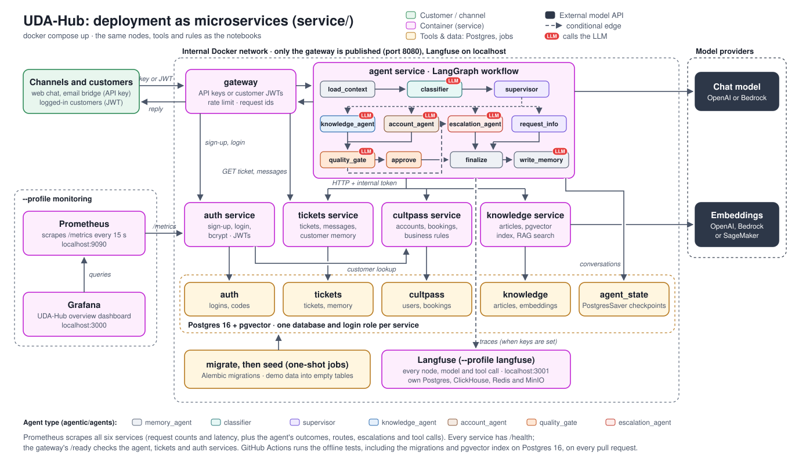

C# UDA-Hub as microservices

This folder runs UDA-Hub as five services behind an API gateway, with Postgres. The approach follows
[fastapi-langgraph-agent-production-ready-template](https://github.com/wassim249/fastapi-langgraph-agent-production-ready-template),
but splits the system along the lines that already exist in the code: the CultPass system, ticket storage,
the knowledge base, and the agents, plus an auth service for customer logins.

The agents, prompts, routing rules and tools are the ones in `solution/agentic`, unchanged. Each data function
in `agentic/tools` runs either locally against a database, as in the notebooks, or over HTTP against the
service that owns that data, depending on configuration (see [How the split works](#how-the-split-works)).

**Status:** the services, the Postgres paths, the migrations, the pgvector index and the HTTP flow between the
services are covered by `service/tests`, which CI also runs against Postgres 16 with pgvector. The whole stack,
monitoring and Langfuse included, has been run end to end with `docker compose` and the real model
(`gpt-4o-mini`): the 13 notebook scenarios sent through the gateway behaved as in the notebook, with real
cancellations and refund requests, escalations to the right teams, no errors, and replies in 1 to 13 seconds.
Customer sign-up and login worked, with the token deciding who the customer is. Prometheus counted every turn,
Langfuse traced every message, and the knowledge service searched its pgvector index. Amazon Bedrock is
configured, but a full run waits on AWS approving the account for Anthropic models.

## Architecture



The gateway is the only public entry point. It accepts channel integrations with an API key and logged-in
customers with a JWT access token, which the **auth service** issues after sign-up or login. The **agent service**
runs the whole LangGraph workflow: its nodes are
shown in the order they run, with the same names as in `solution/agentic/workflow.py` (the full workflow, with
each node's role and routing conditions, is [`architecture.svg`](../design/architecture.svg)).
The tickets, cultpass and knowledge services only hold data, each in its own Postgres database, and the auth
service holds the customer logins in its own.

Each node is coloured by its agent type, the module in `agentic/agents` it comes from: gray `memory_agent`
(`load_context`, `finalize`, `write_memory`), teal `classifier`, purple `supervisor` (`supervisor`,
`request_info`), blue `knowledge_agent`, brown `account_agent`, orange `quality_gate` (`quality_gate`, `approve`)
and red `escalation_agent`. A red **LLM** badge marks every node that calls the model; it is not a colour. Green is
the customer, yellow is tools and data, and dashed arrows are conditional routes. This diagram adds magenta for the
containers (gateway, services, monitoring) and dark slate for the external model APIs.

| Service | Owns | Does | Talks to |
|---|---|---|---|
| `gateway` | nothing | The only public endpoint (port 8080). Checks channel API keys or customer access tokens (JWT), keeps customers to their own tickets, rate-limits each caller, adds request ids, and returns only the reply and ticket status, never the agent's trace or internal notes | agent, tickets, auth |
| `agent` | `agent_state` DB (LangGraph checkpoints) | Runs the LangGraph workflow for one customer message, with the agents from `solution/agentic/agents` (see [The agents in the agent service](#the-agents-in-the-agent-service)) | cultpass, tickets, knowledge, the chat model |
| `cultpass` | `cultpass` DB | The CultPass system of record: customers, subscriptions, experiences, reservations, and their rules (quota, premium tier, blocked accounts, free slots) | nothing |
| `tickets` | `tickets` DB | Tickets, messages, UDA-Hub users and long-term customer memory | nothing |
| `knowledge` | `knowledge` DB | Knowledge-base articles and their embedding index, stored with pgvector; RAG search with the keyword fallback (see [Embeddings in Postgres](#embeddings-in-postgres-pgvector)) | the embedding model |
| `auth` | `auth` DB | Customer sign-up (verified by a code sent to their CultPass email) and login; stores bcrypt password hashes and issues the access tokens the gateway checks (see [Customer logins](#customer-logins-jwt)) | cultpass |

Supporting containers:

| Container | Runs | Does |
|---|---|---|
| `db` | Always | Postgres 16: one database and one login role per service |
| `db-setup` | Once per `up`, before `migrate` | Creates any missing service database and login role (`postgres/init-databases.sh`) |
| `migrate` | Once per `up`, before the services | Brings the cultpass, tickets, knowledge and auth databases to the latest schema ([Schema migrations](#schema-migrations)) |
| `seed` | Once per `up`, after `migrate` | Loads the demo data into empty tables |
| `prometheus` | `--profile monitoring` | Scrapes `/metrics` on every service every 15 seconds |
| `grafana` | `--profile monitoring` | The UDA-Hub overview dashboard ([Monitoring](#monitoring)) |
| `langfuse-web`, `langfuse-worker` and their stores | `--profile langfuse` | LLM tracing ([LLM tracing](#llm-tracing-langfuse)) |

Each service has its **own database and its own Postgres role**, which can't connect to any other database.
They share one Postgres server to keep the demo cheap; moving a database to its own server only changes a URL.

Only the agent and knowledge services get model credentials (`llm.env`), and only the agent can write to
CultPass. Internal services accept a request only with the shared `INTERNAL_API_TOKEN`.

### The agents in the agent service

The agent service runs the same graph as the notebooks (`solution/agentic/workflow.py`), with the same node
names. Only the data calls change: they go to the service that owns the data.

| Node | Module | Uses the LLM | Calls |
|---|---|---|---|
| `load_context` | `memory_agent.py` | No | tickets service (ticket, messages, memories), cultpass service (customer profile) |
| `classifier` | `classifier.py` | Yes | nothing |
| `supervisor` | `supervisor.py` | No | cultpass service (find a guest by email), tickets service (link the ticket) |
| `request_info` | `supervisor.py` | Only to translate | nothing |
| `knowledge_agent` | `knowledge_agent.py` | Yes | knowledge service (RAG search) |
| `account_agent` | `account_agent.py` | Yes (`create_agent` with tools) | cultpass service (account, bookings, subscription), tickets service (refund request note), knowledge service (search) |
| `quality_gate`, `approve` | `quality_gate.py` | `quality_gate` only | nothing |
| `escalation_agent` | `escalation_agent.py` | Yes | tickets service (handoff note) |
| `finalize` | `memory_agent.py` | No | tickets service (reply, ticket status) |
| `write_memory` | `memory_agent.py` | Yes | tickets service (customer memory) |

## How the split works

The data functions in `solution/agentic/tools` (for example `cultpass_tools.reserve_experience` or
`ticket_tools.add_message`) carry a `@remote("cultpass")` or `@remote("tickets")` decorator:

- **No service URL set** (notebooks, `solution/tests`): the function runs locally against SQLite, as before.
- **`CULTPASS_SERVICE_URL` set** (the agent container): the call goes to the function of the same name in
  `agentic/remote/cultpass.py`, which sends it to the CultPass service over HTTP. Same arguments, same result.
- **In a service that owns the data**: the service runs the same function locally against its own Postgres
  database, so each business rule is still written once.

`get_retriever()` works the same way for the knowledge base. Because the agents and tools don't change,
the safeguards hold in both modes: tools are still bound to one customer, booking still requires an id the
agent looked up, and policy decisions are still made in code.

What the services add:

| Concern | How |
|---|---|
| Conversation state | `PostgresSaver` checkpointer in `agent_state`: any agent replica can continue any ticket, and conversations survive restarts |
| Two messages on one ticket at once | Each turn holds a Postgres advisory lock on the ticket id, across replicas |
| Two customers booking the last slot | The experience row is locked (`SELECT ... FOR UPDATE`) while a booking or cancellation runs |
| A service is down | Tool calls return a structured error the agent explains; other failures hit the workflow's existing fallback reply and flag the ticket for a human. Failed connections are retried twice |
| Tracing one message | The gateway's `X-Request-ID` is forwarded on every internal call and appears in every service's JSON logs |
| Metrics | `/metrics` on every service (request count and latency by route), plus what the agent did with each message (outcome, route, escalation team and priority, tools called); scraped by the optional Prometheus and shown in Grafana |
| Schema changes | Alembic migrations, one history per database, applied by the `migrate` job before the services start |
| Health | `/health` on every service checks its database; the gateway's `/ready` checks the services behind it |
| Who the customer is | Channels (API key) pass the customer in the metadata, as before. For a logged-in customer the gateway sets it from their verified JWT and ignores identity fields in the metadata, so the agent runs exactly as it would for a channel, but with an identity that was proven ([Customer logins](#customer-logins-jwt)) |

## Running it

Requires Docker with Compose v2. From `service/`:

```bash
cp .env.example .env          # API keys, internal token, database passwords
cp llm.env.example llm.env    # OpenAI key, or Bedrock / SageMaker settings
docker compose up --build
```

Three one-shot jobs run on every `up`:

1. `db-setup` creates any missing database and login role, one per service (`postgres/init-databases.sh`).
   It only adds what is missing, so a database added later, like `auth`, also appears in an existing volume.
2. `migrate` brings the cultpass, tickets, knowledge and auth databases to the latest schema
   (`scripts/migrate.py`, see [Schema migrations](#schema-migrations)).
3. `seed` copies the committed demo data from the SQLite files into them (`scripts/seed.py`). It skips any
   table that already has rows, so restarts never overwrite data.

The services start only after they succeed. To reload the demo data:

```bash
docker compose run --rm seed python -m service.scripts.seed --reset
```

Send a message (use the same ticket id for the whole conversation):

```bash
curl -s localhost:8080/v1/tickets/T-100/messages \
  -H 'X-API-Key: change-me-web-chat-key' -H 'Content-Type: application/json' \
  -d '{"text": "How do I reset my password?"}'
# {"ticket_id":"T-100","reply":"...","status":"resolved","escalated_to":null}

curl -s localhost:8080/v1/tickets/T-100/messages -H 'X-API-Key: change-me-web-chat-key' \
  -H 'Content-Type: application/json' \
  -d '{"text": "Cancel my reservation", "metadata": {"email": "cathy.bloom@florals.org"}}'

curl -s localhost:8080/v1/tickets/T-100 -H 'X-API-Key: change-me-web-chat-key'
curl -s localhost:8080/v1/tickets/T-100/messages -H 'X-API-Key: change-me-web-chat-key'
```

`status` is `resolved`, `awaiting_customer`, `escalated`, or `error` (the fallback reply was sent and the
ticket was flagged for a human). The interactive API docs are at <http://localhost:8080/docs>.

For demos, the gateway also serves a web chat at <http://localhost:8080/demo> (`gateway/demo.html`). Pick a
demo customer or a guest, type or click a suggested message, and each reply shows its status and the team it
was escalated to. The page holds no secret: enter a channel API key in the sidebar (or open
`/demo?key=<key>` once), and it stays in that browser. Every message goes through the same authenticated
endpoint as any other client.

### Customer logins (JWT)

Besides channel integrations with an API key, customers can log in and call the API themselves. Only CultPass
customers can sign up, and only by proving they own their email:

```bash
# 1. Ask for a verification code. The answer is the same whether or not the email is a customer's.
curl -s localhost:8080/v1/auth/register/start -H 'Content-Type: application/json' \
  -d '{"email": "cathy.bloom@florals.org"}'

# In this demo the code is written to the auth service's log instead of emailed:
docker compose logs auth | grep 'Verification code'

# 2. The code and a password (at least 10 characters, with a letter and a digit) create the login
curl -s localhost:8080/v1/auth/register/complete -H 'Content-Type: application/json' \
  -d '{"email": "cathy.bloom@florals.org", "code": "123456", "password": "Florals-2026-ok"}'

# 3. Log in with the password. A login code is then emailed (logged, in this demo): 202, no token yet
curl -s localhost:8080/v1/auth/login -H 'Content-Type: application/json' \
  -d '{"email": "cathy.bloom@florals.org", "password": "Florals-2026-ok"}'
docker compose logs auth | grep 'Login code'

# 4. The login code: {"access_token": "...", "token_type": "bearer", "expires_at": "..."}
curl -s localhost:8080/v1/auth/login/verify -H 'Content-Type: application/json' \
  -d '{"email": "cathy.bloom@florals.org", "code": "654321"}'

# 5. Use the token instead of an API key
curl -s localhost:8080/v1/tickets/T-200/messages -H "Authorization: Bearer $TOKEN" \
  -H 'Content-Type: application/json' -d '{"text": "What are my reservations?"}'
```

How it works:

- **Who the customer is comes from the token.** The gateway verifies the token itself (HS256 signature, issuer,
  audience, type and expiry, in `common/tokens.py`) and sets the customer from it. Identity fields in the
  message metadata (`email`, `external_user_id`, `user_name`, `account_id`) are ignored, so a customer can't
  act as someone else by typing another email.
- **Customers only see their own tickets.** Another customer's ticket, or a guest ticket a channel started,
  answers `404` exactly like a missing one, so ticket ids can't be probed. Channels with an API key still see
  every ticket.
- **Sign-up is verified.** A 6-digit code goes to the CultPass email and expires after 10 minutes. It works
  once, and five wrong guesses burn it. Only an HMAC of the code is stored. A new code can be asked for after
  60 seconds.
- **Login takes two steps.** The right password gets no token: it sends a 6-digit login code to the
  customer's email, with the same rules as a sign-up code (10 minutes, works once, five wrong guesses burn
  it, only an HMAC stored, no new code within 60 seconds). The code gets the token, so a stolen password
  alone is not enough. A sign-up code can never pass as a login code: the purpose is part of the HMAC.
  `AUTH_LOGIN_CODES=false` turns the second step off.
- **Passwords** are stored as bcrypt hashes. Five wrong passwords or login codes in a row lock the login for 15
  minutes, and the count only resets after a complete login, so someone who knows the password gets no extra
  guesses at the code. A wrong password, an unknown email and a locked login all get the same `401`, and take
  about as long.
- **Tokens** last 60 minutes (`JWT_TTL_MINUTES`). There is no refresh token: the customer logs in again.
- **Rate limits:** sign-up and login are limited per client IP (10 a minute), and each logged-in customer
  has their own budget, like each API key.

### Embeddings in Postgres (pgvector)

The database image (`postgres/Dockerfile`) is `postgres:16-alpine` with the
[pgvector](https://github.com/pgvector/pgvector) extension, which `db-setup` enables in the `knowledge` database.
The knowledge service keeps each article's embedding in the table `knowledge_embeddings`
(`knowledge_service/pgvector_index.py`) and searches it with cosine distance (`<=>`):

- **Only new or changed articles are embedded**, at startup or on `POST /accounts/{id}/reindex`. A restart
  embeds nothing; editing an article embeds that one again. Rows of deleted articles go with them, and when
  `seed --reset` reloads every article, the first search finds the index empty and embeds them again.
- **One index for every replica** of the knowledge service, instead of one in-memory copy each.
- **Each embedding model has its own vectors.** Rows record the model, so switching `UDAHUB_EMBEDDING_MODEL`
  (e.g. OpenAI to Titan) embeds everything once and never compares vectors of different models.
- **Scores are unchanged:** cosine similarity, so `UDAHUB_RAG_MIN_SCORE` means the same as in memory.

The table is a derived index, rebuilt from the articles at any time, so the service creates it itself and it
is outside the Alembic migrations (like the agent's checkpoint tables). Search is an exact scan, which suits a
knowledge base this size; an HNSW index would be the next step for many thousands of articles. If pgvector is
missing, the service logs a warning and keeps the index in memory. To look at it:

```bash
docker compose exec db psql -U postgres -d knowledge \
  -c "SELECT model, count(*), vector_dims(embedding) FROM knowledge_embeddings GROUP BY 1, 3"
```

### Monitoring

```bash
docker compose --profile monitoring up --build
```

This also starts Prometheus on <http://localhost:9090> and Grafana on <http://localhost:3000> (user `admin`,
password `GRAFANA_ADMIN_PASSWORD` from `.env`). Both listen on localhost only. Grafana opens on the
**UDA-Hub overview** dashboard:

- **Overview** for the selected time range: services up, customer messages, the share resolved and the share
  escalated, p95 reply time, and the share of server errors.
- **Support outcomes**: messages by outcome and by route over time, escalations by team and by priority,
  and tool calls.
- **Traffic and latency**: requests and 5xx errors by service, reply time (p50, p95, p99), p95 latency by
  service, requests the gateway rejected (401 bad key, 429 rate limited), the slowest routes, and service
  health.

The datasource and the dashboard are provisioned from `monitoring/grafana`, so they are recreated with the
container. To change the dashboard, edit `monitoring/grafana/dashboards/udahub.json` (or edit a copy in the UI
and export its JSON into that file). Grafana picks up changes to the file within about 10 seconds.

Counts over a time range use Prometheus's `increase()`, which extrapolates to the edges of the range, so a
small count can read slightly high (for example 5 for 4 messages).

### LLM tracing (Langfuse)

```bash
docker compose --profile langfuse up --build
# both profiles at once:
docker compose --profile monitoring --profile langfuse up --build
```

This also starts a self-hosted [Langfuse](https://langfuse.com) on <http://localhost:3001> (localhost only).
Log in with `LANGFUSE_ADMIN_EMAIL` and `LANGFUSE_ADMIN_PASSWORD` from `.env`; the **UDA-Hub** organisation,
the **UDA-Hub agent** project and its API keys (`LANGFUSE_PUBLIC_KEY`, `LANGFUSE_SECRET_KEY`) are created on
first start, so the agent sends traces with no setup in the UI.

Each customer message is one trace named `udahub-ticket`: every graph node, every model call with its prompt,
response and token counts, and every tool call. Traces are grouped into a session per ticket id, so the turns
of one conversation sit together, and tagged with the account and channel. The user is the CultPass
`external_user_id` when the channel sends it; emails are never sent to Langfuse. Prometheus answers "how many
and how fast"; Langfuse answers "what exactly did the model see and say".

Langfuse runs as its web app and worker plus its own Postgres, ClickHouse, Redis and MinIO, adapted from
Langfuse's `docker-compose.yml` for v4.78.0. Tracing is code in `solution/agentic/tracing.py` and is off
whenever the two keys are empty, so the stack without this profile is unchanged. If the keys are set but the
profile isn't running, the agent still works and logs that it can't reach Langfuse.

The notebooks can send traces to the same Langfuse: set `LANGFUSE_PUBLIC_KEY`, `LANGFUSE_SECRET_KEY` and
`LANGFUSE_BASE_URL=http://localhost:3001` in `solution/.env`.

### Schema migrations

Each service database has its own [Alembic](https://alembic.sqlalchemy.org) history in
`migrations/<database>/versions`, configured in `alembic.ini` (one section per database). The models stay in
`solution/data/models`; the tickets and knowledge histories each cover only their own tables.

| Database | URL variable | Tables |
|---|---|---|
| `cultpass` | `CULTPASS_DB_URL` | users, subscriptions, experiences, reservations |
| `tickets` | `TICKETS_DB_URL` | accounts, users, tickets, ticket_metadata, ticket_messages, customer_memory |
| `knowledge` | `KNOWLEDGE_DB_URL` | accounts, knowledge |

To change the schema, edit the model, then generate and review a revision. From the repository root, with the
database's URL set (for example a local Postgres, or a scratch SQLite file):

```bash
export TICKETS_DB_URL=postgresql+psycopg://...    # a database at the current head
alembic -c service/alembic.ini -n tickets revision --autogenerate --rev-id 0002 -m "add ticket priority"
# review service/migrations/tickets/versions/0002_add_ticket_priority.py, then:
python -m service.scripts.migrate tickets         # or: docker compose up, which runs the migrate job
```

Other commands: `alembic -c service/alembic.ini -n <database> current | history | downgrade -1`, and
`upgrade head --sql` to print the SQL without running it.

- `service/tests/test_migrations.py` fails if a model changes without a matching revision, if a history has two
  heads, or if a downgrade doesn't undo its upgrade.
- Databases created before migrations existed (the old `seed` made the tables itself) are recognised by having
  every table but no `alembic_version`. The `migrate` job stamps them at the first revision and keeps their
  data. A database with only some of the tables is refused.
- The `agent_state` database isn't in Alembic: LangGraph's `PostgresSaver.setup()` creates and upgrades the
  checkpoint tables when the agent starts.

### Public API (gateway)

| Method and path | Body | Returns |
|---|---|---|
| `POST /v1/tickets/{ticket_id}/messages` | `{"text": "...", "metadata": {...}}`; metadata is optional: `email` or `external_user_id`, `channel`, `urgency`, `account_id` | `{ticket_id, reply, status, escalated_to}` |
| `GET /v1/tickets/{ticket_id}` | | `{ticket_id, status, channel, issue_type}` |
| `GET /v1/tickets/{ticket_id}/messages` | | The conversation as the customer saw it; system notes (escalation handoffs, refund requests) are left out |
| `POST /v1/auth/register/start` | `{"email"}` | `202`, with the same message whether or not a code was sent |
| `POST /v1/auth/register/complete` | `{"email", "code", "password"}` | `201` `{access_token, token_type, expires_at}`; `400` for a wrong or expired code |
| `POST /v1/auth/login` | `{"email", "password"}` | `202` `{detail, code_required}`: a login code was emailed; `401` otherwise. With login codes turned off, `{access_token, token_type, expires_at}` |
| `POST /v1/auth/login/verify` | `{"email", "code"}` | `{access_token, token_type, expires_at}`; `401` for a wrong or expired code, or a locked login |

The ticket endpoints take either credential:

- **`X-API-Key`** for channel integrations (web chat, email bridge). They are trusted: as in the original
  design, metadata such as the customer's email is taken as given, and they can see every ticket.
- **`Authorization: Bearer <access token>`** for logged-in customers. The customer comes from the token, and
  they can only see and continue their own tickets (see [Customer logins](#customer-logins-jwt)).

## Tests

From the repository root, with the dependencies of `requirements.txt` and `service/requirements.txt` installed:

```bash
python -m pytest service/tests
```

The tests run every service in the same process against copies of the SQLite databases, with the agent's
calls going through real HTTP requests (FastAPI `TestClient`) and only the LLM scripted. They cover the
service APIs, internal-token and API-key checks, rate limiting, the full gateway → agent → services flow,
multi-turn conversations, escalation, memory, the agent metrics, a service outage mid-turn, and the demo web
chat.

The migration tests run on SQLite. To also run them on Postgres, and to run the pgvector tests
(`tests/test_pgvector.py`), as CI does, give them a role that can create databases on a server with pgvector
(each test uses its own new database and drops it afterwards). The `udahub-postgres:16-pgvector` image that
`docker compose build` makes works, as does `pgvector/pgvector:pg16`:

```bash
UDAHUB_TEST_POSTGRES_URL=postgresql+psycopg://postgres:<password>@localhost:5432/postgres python -m pytest service/tests
```

## Configuration

| Variable | Used by | Meaning |
|---|---|---|
| `GATEWAY_API_KEYS` | gateway | Comma-separated client keys |
| `GATEWAY_RATE_LIMIT_PER_MINUTE` | gateway | Requests per key per minute (default 30) |
| `INTERNAL_API_TOKEN` | all | Shared secret for service-to-service calls; services refuse requests without it |
| `CULTPASS_DB_URL`, `UDAHUB_DB_URL` | cultpass; tickets and knowledge | SQLAlchemy URL of the service's own database |
| `CULTPASS_DB_URL`, `TICKETS_DB_URL`, `KNOWLEDGE_DB_URL` | migrate and seed jobs | The three service databases |
| `CULTPASS_SERVICE_URL`, `TICKET_SERVICE_URL`, `KNOWLEDGE_SERVICE_URL` | agent | Where the other services are; the agent refuses to start without all three |
| `AGENT_STATE_DB_URL` | agent | Postgres URL of the checkpointer; without it, conversations live in memory |
| `UDAHUB_VECTOR_STORE` | knowledge | `pgvector` (the default in docker-compose): article embeddings in the knowledge database. `memory`: rebuilt in memory on every start, as in the notebooks |
| `UDAHUB_SERVICE_TIMEOUT` | agent | Seconds per internal call (default 15) |
| Model settings (`llm.env`) | agent, knowledge | As in `solution/.env.example` |
| `GRAFANA_ADMIN_PASSWORD` | grafana | Password of Grafana's `admin` user (default `admin`) |
| `JWT_SECRET_KEY` | auth, gateway | Signs (auth) and verifies (gateway) customer access tokens; at least 32 characters. Without it the gateway accepts API keys only |
| `JWT_TTL_MINUTES` | auth | How long an access token is valid (default 60) |
| `GATEWAY_AUTH_RATE_LIMIT_PER_MINUTE` | gateway | Sign-up and login requests per client IP per minute (default 10) |
| `AUTH_DB_URL` | auth, migrate | SQLAlchemy URL of the auth database |
| `AUTH_DB_PASSWORD` | db, db-setup | Password of the auth database's login role |
| `AUTH_CODE_TTL_MINUTES`, `AUTH_CODE_RESEND_SECONDS`, `AUTH_CODE_MAX_ATTEMPTS` | auth | Sign-up and login codes: lifetime (default 10), wait before a new one (60), wrong guesses allowed (5) |
| `AUTH_LOGIN_CODES` | auth | Whether login needs the emailed code after the password (default `true`) |
| `AUTH_MAX_FAILED_LOGINS`, `AUTH_LOCKOUT_MINUTES` | auth | Wrong passwords or login codes before the login locks (default 5), and for how long (15) |
| `LANGFUSE_PUBLIC_KEY`, `LANGFUSE_SECRET_KEY` | agent, langfuse-web | The Langfuse project's API keys (`pk-lf-…`, `sk-lf-…`), created on Langfuse's first start; tracing is off when they are empty |
| `LANGFUSE_ADMIN_EMAIL`, `LANGFUSE_ADMIN_PASSWORD` | langfuse-web | The Langfuse login created on first start |
| `LANGFUSE_NEXTAUTH_SECRET`, `LANGFUSE_SALT`, `LANGFUSE_ENCRYPTION_KEY` | langfuse-web, langfuse-worker | Langfuse's own secrets; the encryption key is 64 hex characters (`openssl rand -hex 32`) |
| `LANGFUSE_DB_PASSWORD`, `LANGFUSE_CLICKHOUSE_PASSWORD`, `LANGFUSE_REDIS_PASSWORD`, `LANGFUSE_MINIO_PASSWORD` | Langfuse and its stores | Passwords of Langfuse's Postgres, ClickHouse, Redis and MinIO |
| `LANGFUSE_PORT` | langfuse-web | Port of the Langfuse UI on localhost (default 3001) |

## Limitations

- The demo experiences in the committed `cultpass.db` are dated 1 to 7 days after the day it was built
  (12 to 18 November 2026). Once those dates pass, searches return nothing and bookings fail, in the services
  as in the notebooks (the tests are unaffected: they move the dates to today). Rebuild the database with
  `01_external_db_setup.ipynb` before seeding.
- The rate limit is kept in each gateway replica's memory. With several gateway replicas, move it to Redis
  (or Valkey, as the template does).
- A message is answered in one HTTP request that lasts as long as the LLM calls (often 5 to 20 seconds).
  Streaming (SSE) or a queue with callbacks would suit chat front ends better.
- The CultPass service shares the rule functions in `agentic/tools` with the notebooks instead of having its
  own copy. That keeps one source of truth for this project; a real CultPass would be a separate system.
- The gateway's `/metrics` is reachable through the published port. In production, publish the gateway behind
  a proxy that serves only `/v1`.
- Service-to-service calls use one shared token over the private Docker network, not mTLS or per-service
  identities.
- Verification codes are written to the auth service's log, not emailed (`deliver_code` in
  `auth_service/main.py`). Before real use, send them with an email provider and stop logging them.
- Customer tokens can't be revoked before they expire: there is no logout, refresh token or deny-list, and
  there is no password reset yet. Keep `JWT_TTL_MINUTES` short.
- The auth service and the gateway share one signing key (HS256). With RS256 or EdDSA, the gateway would hold
  only a public key and could not create tokens.
