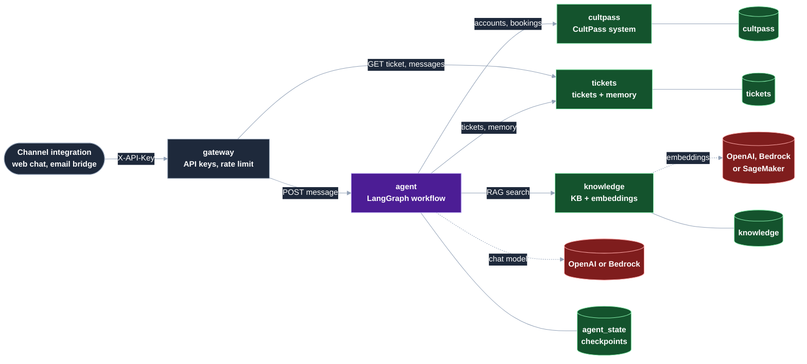

# UDA-Hub as microservices

This folder runs UDA-Hub as five services behind one API gateway, with Postgres. The approach follows
[fastapi-langgraph-agent-production-ready-template](https://github.com/wassim249/fastapi-langgraph-agent-production-ready-template),
but splits the system along the lines that already exist in the code: the CultPass system, ticket storage,
the knowledge base, and the agents.

The agents, prompts, routing rules and tools are the ones in `solution/agentic`, unchanged. Each data function
in `agentic/tools` runs either locally against a database, as in the notebooks, or over HTTP against the
service that owns that data, depending on configuration (see [How the split works](#how-the-split-works)).

**Status:** the services, the Postgres paths and the HTTP flow between the services are covered by
`service/tests` and were checked against a local Postgres 16. The Docker images and `docker compose` have not
been built or run yet (Docker wasn't available when this was written).

## Architecture



| Service | Owns | Does | Talks to |
|---|---|---|---|
| `gateway` | nothing | The only public endpoint (port 8080). Checks API keys, rate-limits each key, adds request ids, and returns only the reply and ticket status, never the agent's trace or internal notes | agent, tickets |
| `agent` | `agent_state` DB (LangGraph checkpoints) | Runs the workflow for one customer message: classifier, supervisor, resolvers, quality gate, escalation, memory | cultpass, tickets, knowledge, the chat model |
| `cultpass` | `cultpass` DB | The CultPass system of record: customers, subscriptions, experiences, reservations, and their rules (quota, premium tier, blocked accounts, free slots) | nothing |
| `tickets` | `tickets` DB | Tickets, messages, UDA-Hub users and long-term customer memory | nothing |
| `knowledge` | `knowledge` DB | Knowledge-base articles and their embedding index; RAG search with the keyword fallback | the embedding model |

Each service has its **own database and its own Postgres role**, which can't connect to any other database.
They share one Postgres server to keep the demo cheap; moving a database to its own server only changes a URL.

Only the agent and knowledge services get model credentials (`llm.env`), and only the agent can write to
CultPass. Internal services accept a request only with the shared `INTERNAL_API_TOKEN`.

## How the split works

The data functions in `solution/agentic/tools` (for example `cultpass_tools.reserve_experience` or
`ticket_tools.add_message`) carry a `@remote("cultpass")` or `@remote("tickets")` decorator:

- **No service URL set** (notebooks, `solution/tests`): the function runs locally against SQLite, as before.
- **`CULTPASS_SERVICE_URL` set** (the agent container): the call goes to the function of the same name in
  `agentic/remote/cultpass.py`, which sends it to the CultPass service over HTTP. Same arguments, same result.
- **In a service that owns the data**: the service runs the same function locally against its own Postgres
  database, so each business rule is still written once.

`get_retriever()` works the same way for the knowledge base. Because the agents and tools don't change,
the safeguards hold in both modes: tools are still bound to one customer, booking still requires an id the
agent looked up, and policy decisions are still made in code.

What the services add:

| Concern | How |
|---|---|
| Conversation state | `PostgresSaver` checkpointer in `agent_state`: any agent replica can continue any ticket, and conversations survive restarts |
| Two messages on one ticket at once | Each turn holds a Postgres advisory lock on the ticket id, across replicas |
| Two customers booking the last slot | The experience row is locked (`SELECT ... FOR UPDATE`) while a booking or cancellation runs |
| A service is down | Tool calls return a structured error the agent explains; other failures hit the workflow's existing fallback reply and flag the ticket for a human. Failed connections are retried twice |
| Tracing one message | The gateway's `X-Request-ID` is forwarded on every internal call and appears in every service's JSON logs |
| Metrics | `/metrics` on every service (request count and latency by route), scraped by the optional Prometheus |
| Health | `/health` on every service checks its database; the gateway's `/ready` checks the services behind it |

## Running it

Requires Docker with Compose v2. From `service/`:

```bash
cp .env.example .env          # API keys, internal token, database passwords
cp llm.env.example llm.env    # OpenAI key, or Bedrock / SageMaker settings
docker compose up --build
```

On first start, Postgres creates the four databases and roles (`postgres/init-databases.sh`), and the `seed`
job copies the committed demo data from the SQLite files into them (`scripts/seed.py`). The seed skips any
table that already has rows, so restarts never overwrite data. To reload the demo data:

```bash
docker compose run --rm seed python -m service.scripts.seed --reset
```

Send a message (use the same ticket id for the whole conversation):

```bash
curl -s localhost:8080/v1/tickets/T-100/messages \
  -H 'X-API-Key: change-me-web-chat-key' -H 'Content-Type: application/json' \
  -d '{"text": "How do I reset my password?"}'
# {"ticket_id":"T-100","reply":"...","status":"resolved","escalated_to":null}

curl -s localhost:8080/v1/tickets/T-100/messages -H 'X-API-Key: change-me-web-chat-key' \
  -H 'Content-Type: application/json' \
  -d '{"text": "Cancel my reservation", "metadata": {"email": "cathy.bloom@florals.org"}}'

curl -s localhost:8080/v1/tickets/T-100 -H 'X-API-Key: change-me-web-chat-key'
curl -s localhost:8080/v1/tickets/T-100/messages -H 'X-API-Key: change-me-web-chat-key'
```

`status` is `resolved`, `awaiting_customer`, `escalated`, or `error` (the fallback reply was sent and the
ticket was flagged for a human). The interactive API docs are at <http://localhost:8080/docs>.

Monitoring: `docker compose --profile monitoring up --build` also starts Prometheus on <http://localhost:9090>.

### Public API (gateway)

| Method and path | Body | Returns |
|---|---|---|
| `POST /v1/tickets/{ticket_id}/messages` | `{"text": "...", "metadata": {...}}`; metadata is optional: `email` or `external_user_id`, `channel`, `urgency`, `account_id` | `{ticket_id, reply, status, escalated_to}` |
| `GET /v1/tickets/{ticket_id}` | | `{ticket_id, status, channel, issue_type}` |
| `GET /v1/tickets/{ticket_id}/messages` | | The conversation as the customer saw it; system notes (escalation handoffs, refund requests) are left out |

API callers are trusted channel integrations, not end customers: as in the original design, metadata such as
the customer's email is taken as given.

## Tests

From the repository root, with the dependencies of `requirements.txt` and `service/requirements.txt` installed:

```bash
python -m pytest service/tests
```

The tests run every service in the same process against copies of the SQLite databases, with the agent's
calls going through real HTTP requests (FastAPI `TestClient`) and only the LLM scripted. They cover the
service APIs, internal-token and API-key checks, rate limiting, the full gateway → agent → services flow,
multi-turn conversations, escalation, memory, and a service outage mid-turn.

## Configuration

| Variable | Used by | Meaning |
|---|---|---|
| `GATEWAY_API_KEYS` | gateway | Comma-separated client keys |
| `GATEWAY_RATE_LIMIT_PER_MINUTE` | gateway | Requests per key per minute (default 30) |
| `INTERNAL_API_TOKEN` | all | Shared secret for service-to-service calls; services refuse requests without it |
| `CULTPASS_DB_URL`, `UDAHUB_DB_URL` | cultpass; tickets and knowledge | SQLAlchemy URL of the service's own database |
| `CULTPASS_SERVICE_URL`, `TICKET_SERVICE_URL`, `KNOWLEDGE_SERVICE_URL` | agent | Where the other services are; the agent refuses to start without all three |
| `AGENT_STATE_DB_URL` | agent | Postgres URL of the checkpointer; without it, conversations live in memory |
| `UDAHUB_SERVICE_TIMEOUT` | agent | Seconds per internal call (default 15) |
| Model settings (`llm.env`) | agent, knowledge | As in `solution/.env.example` |

## Limitations

- The demo experiences in the committed `cultpass.db` are dated 1 to 7 days after the day it was built
  (10 to 16 November 2026). Once those dates pass, searches return nothing and bookings fail, in the services
  as in the notebooks (the tests are unaffected: they move the dates to today). Rebuild the database with
  `01_external_db_setup.ipynb` before seeding.
- The rate limit is kept in each gateway replica's memory. With several gateway replicas, move it to Redis
  (or Valkey, as the template does).
- A message is answered in one HTTP request that lasts as long as the LLM calls (often 5 to 20 seconds).
  Streaming (SSE) or a queue with callbacks would suit chat front ends better.
- The CultPass service shares the rule functions in `agentic/tools` with the notebooks instead of having its
  own copy. That keeps one source of truth for this project; a real CultPass would be a separate system.
- The gateway's `/metrics` is reachable through the published port. In production, publish the gateway behind
  a proxy that serves only `/v1`.
- Service-to-service calls use one shared token over the private Docker network, not mTLS or per-service
  identities.
