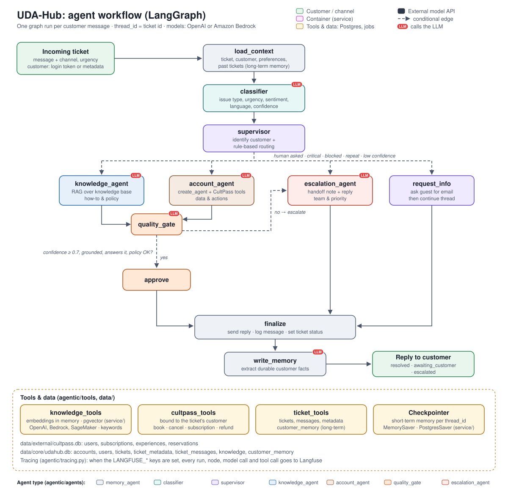

# UDA-Hub: Project Guide

This folder contains the complete, working UDA-Hub project. UDA-Hub is a LangGraph multi-agent
system that resolves customer support tickets for CultPass. It classifies each ticket, routes it to the right
agent, and then either resolves it (with RAG and account tools) or escalates it to a human. It uses short- and
long-term memory throughout.

The full architecture, routing rules and memory design are in [`../design`](../design/README.md).
Its [Safeguards](../design/README.md#safeguards-the-llm-proposes-code-decides) section lists every business rule
and policy that is enforced in code rather than left to the model.

## How a ticket flows



Each node is coloured by its agent type, the module in `agentic/agents` it comes from: gray `memory_agent`
(`load_context`, `finalize`, `write_memory`), teal `classifier`, purple `supervisor` (`supervisor`,
`request_info`), blue `knowledge_agent`, brown `account_agent`, orange `quality_gate` (`quality_gate`, `approve`)
and red `escalation_agent`. A red **LLM** badge marks every node that calls the model; it is not a colour. Green is
the customer, yellow is tools and data, and dashed arrows are conditional routes. The node names are the ones in
`agentic/workflow.py`. When deployed as microservices, the same nodes run inside the agent service: see
[`deployment.svg`](../design/deployment.svg), which uses the same colours.

| Node | What it does |
|---|---|
| `classifier` | Gives the ticket a structured classification: issue type, urgency, sentiment, language, whether account action is needed, and confidence |
| `supervisor` | Identifies the customer (from metadata, or an email in the conversation once the customer types the code sent to it; as microservices, a logged-in customer is already identified by their access token) and routes the ticket with deterministic rules. It escalates before `knowledge_agent` or `account_agent` runs when the customer asks for a human, the issue is legal or critical, the classifier isn't confident, a blocked customer has an account issue, or the customer reports a problem they reported before |
| `knowledge_agent` | Answers how-to and policy questions with RAG over the 18 knowledge base articles |
| `account_agent` | A ReAct agent (LangChain `create_agent`) with CultPass tools bound to the current customer: account, reservations, booking, cancellation, subscription changes and refund requests. Booking and cancellation only accept ids that a lookup returned in the same turn |
| `quality_gate` | Scores the draft reply for confidence and checks that it is backed by the articles or tool results. It escalates on low confidence (< 0.7), an unsupported draft, or a policy that needs a human (such as a refund) |
| `escalation_agent` | Picks the human team and priority, saves a handoff note on the ticket, and replies to the customer |
| `load_context`, `write_memory` | Memory. Short-term: the conversation per ticket thread (`MemorySaver` here, `PostgresSaver` in the [agent service](../service/README.md)). Long-term: customer preferences and reported issues (`customer_memory` table) and previous tickets in `udahub.db`. The memory writer only sees the customer's own messages. Reservation state, named experiences, one-off requests, contact details and duplicates are filtered out |

## Running it

From the repository root:

```bash
python -m venv .venv && source .venv/bin/activate
pip install -r requirements.txt
cd solution
cp .env.example .env        # add OPENAI_API_KEY (and OPENAI_BASE_URL if using Vocareum)
```

Put the key in `.env`, which git ignores, and never in `.env.example`, which is committed.

`03_agentic_app.ipynb` is committed with the outputs of a real run (see below), so you can review it without a key.
To run it yourself, open it straight away: both databases are included. It runs the demo scenarios, then an
interactive chat (`chat_interface(orchestrator, "1")`).

To use Amazon Bedrock or a SageMaker embedding endpoint instead of OpenAI, see the
[root README](../README.md#sagemaker-embeddings) and `.env.example`.

To trace runs in Langfuse (each node, model call and tool call, grouped by ticket), start the self-hosted Langfuse
with `docker compose --profile langfuse up` from `service/`, then add `LANGFUSE_PUBLIC_KEY`, `LANGFUSE_SECRET_KEY`
(both from `service/.env`) and `LANGFUSE_BASE_URL=http://localhost:3001` to `.env`. The notebook demos and
`chat_interface` are then traced on <http://localhost:3001>. Without these keys, tracing is off. See the
[root README](../README.md#tracing-with-langfuse-optional).

The notebooks have no login: they call `process_ticket()` directly, and the customer comes from the metadata or
an email given in the chat. Customer sign-up and login (JWT access tokens) exist only when UDA-Hub runs as
microservices; see the [root README](../README.md#customer-logins-microservices) and
[`service/README.md`](../service/README.md#customer-logins-jwt).

The demos make real changes: bookings and cancellations, plus new tickets and memories. To reset the data, re-run:

1. `01_external_db_setup.ipynb`, which rebuilds `data/external/cultpass.db`
2. `02_core_db_setup.ipynb`, which rebuilds `data/core/udahub.db`

## Demo results (notebook 03)

`03_agentic_app.ipynb` is committed with the outputs of a run against the real model (`gpt-4o-mini`, with
`text-embedding-3-small` for retrieval), so you can read every decision trace and reply without running it.

| # | Ticket | What happened | Long-term memory |
|---|---|---|---|
| 1 | Guest asks what a subscription includes | knowledge_agent (top article scored 0.78) → resolved | None (guest) |
| 2 | Cathy asks about her reservations, then "cancel that one" | account_agent lists them, then cancels on the follow-up (short-term memory) → resolved | Cancellation dropped by the filter |
| 3 | Guest asks to book Samba Night, gives their email, then the code sent to it | request_info → code sent → code verified, Bob identified → account_agent's search shows he already has that booking, so it tells him | None (no duplicate preference) |
| 4 | Alice (blocked account) can't log in | supervisor → escalated to Trust & Safety without revealing the reason for the block | Login issue recorded |
| 5 | Frank was charged twice | account_agent → `request_refund` → escalated to billing for support-lead approval | Refund request recorded |
| 6 | Bob still can't log in | supervisor → escalated to technical support as a repeat issue (his previous ticket was a login problem) | Login issue recorded |
| 7 | Bob asks for a recommendation | account_agent → `recommend_experiences` → nothing he can book matches his music and dance preference, so it says so and offers one alternative without claiming it fits | None |
| 8 | Customer demands a human | Escalated immediately | None (one-off request) |
| 9 | Guest says the app keeps crashing | knowledge_agent (App Crashes article, 0.55) → answered with its steps | None (guest) |
| 10 | Guest asks about a student discount | knowledge_agent finds no article above 0.30 → escalated ("no relevant knowledge base article found") | None (guest) |
| 11 | Guest asks about parking | knowledge_agent finds only related articles → quality gate: they don't answer it → escalated | None (guest) |
| 12 | Frank says he loves outdoor activities | account_agent → `recommend_experiences` with the interest he just stated → the two outdoor experiences; the preference is stored in long-term memory | "Likes outdoor activities and nature" |
| 13 | Frank asks for recommendations, in a new session | account_agent, with the preference recalled from `udahub.db` → the same two outdoor experiences | None (already known) |

In most of our runs of scenario 2, the agent first tried to cancel with a guessed id. The tool refused it, and
the agent looked the reservation up before cancelling. The committed run is one of them; in other runs it looked the
reservation up first. The outcome is the same either way, and `test_account_tools_refuse_ids_not_looked_up`
checks the guard directly. The model's wording varies between runs. Asked later whether the cancellation went through, the agent now checks
the reservation with a tool instead of answering from the conversation, which the quality gate used to escalate.

## Tests

These need no API key. They use a scripted fake LLM and temporary copies of the databases.

```bash
python -m pytest tests
```

- `tests/test_tools.py` covers:
  - the tool business rules: blocked accounts, inactive subscriptions, double booking, ownership, quota and subscription transitions
  - account tools bound to one customer, which refuse ids that weren't looked up in the same turn
  - ticket and memory persistence
  - the memory filters (reservation state, named experiences, one-off requests, contact details) and the duplicate check
  - the repeat-issue rule, which escalates repeated problems but not routine requests
  - keyword retrieval
  - every routing and escalation rule
- `tests/test_workflow.py` runs the whole graph end to end through these paths:
  - RAG resolution
  - low-confidence escalation
  - a blocked customer
  - multi-turn identification through the emailed code (and wrong, expired and too many codes), recalling both
    short-term and long-term memory
  - a refund request that forces escalation and writes a new memory
  - a reservation-state memory that is filtered out before it is stored
  - a memory writer that only sees the customer's messages
  - repeat issues, from a previous ticket and from the same ticket, that go straight to a human
  - a structured, searchable event for every decision and tool call
  - an LLM outage or unknown account that gets a fallback reply instead of a crash, and an empty message
  - the real `create_agent` loop with a scripted tool-calling model, and its step limit
- `tests/test_evals.py` checks the evaluation suite's own scoring and runner.
- `tests/test_tracing.py` checks that Langfuse tracing is off without keys, and what each traced run sends.

## Evaluation

The tests script the model, so they can't say how often the real model gets a ticket right. The evaluation
suite runs 36 labelled tickets through the whole system with the real model, several times each, and
reports how often the classification, route, outcome, escalation team, tool calls and reply are right. Replies
are checked by an LLM judge for faithfulness to the evidence and for the points each case expects.

```bash
python -m evals.run            # needs the model settings in .env; 3 runs per case
```

See [`evals/README.md`](evals/README.md) for the checks, the case format, and the options.

**Results:** with `gpt-4o-mini` running the agents and `gpt-4o` judging (`UDAHUB_EVAL_JUDGE_MODEL=gpt-4o`),
**108 of 108 runs passed every check (100%)** in each of the last two evaluations, up from 95 (88%) at the first. The runs
in between scored 94–99%, each missing one or two in different cases, so expect an occasional miss. The fixes
in between: guests' how-to questions are answered from the knowledge base, the quality gate sees the account
details the agent was given, code decides whether a reply waits for the customer and whether a human is needed,
search results say whether the customer can book each experience, and `recommend_experiences` suggests only
what fits their stored preferences. With `gpt-4o-mini` as its own judge the first evaluation scored 69%, mostly
from faithfulness failures on correct answers. The full results are in [`../report.md`](../report.md#evaluation).

## Folder guide

| Path | Contents |
|---|---|
| `agentic/workflow.py` | The LangGraph graph (`orchestrator`) and `process_ticket()` |
| [`agentic/agents/`](agentic/agents/README.md) | `classifier`, `supervisor`, `knowledge_agent`, `account_agent`, `quality_gate`, `escalation_agent`, `write_memory`. The README covers the memory rules and how to add an agent. |
| [`agentic/tools/`](agentic/tools/README.md) | CultPass account tools, RAG retriever, ticket and memory storage. The README covers the rules each tool enforces and how to add a tool. |
| [`../design`](../design/README.md) | Architecture diagram, Mermaid graph, and the design document: routing rules, resolve-or-escalate logic, memory, and safeguards |
| `agentic/config.py` | Models, database paths and decision thresholds |
| `agentic/llm.py` | Chat and embedding models for OpenAI, Amazon Bedrock or a SageMaker endpoint |
| `agentic/remote/` | HTTP clients the tools use when running as microservices ([`service/`](../service/README.md)) |
| `agentic/demo_data.py` | Throwaway copies of the demo databases with the dates moved to today, for the tests and evaluations |
| `agentic/state.py` | Graph state and structured-output schemas |
| `agentic/tracing.py` | Optional Langfuse tracing: adds the Langfuse callback, session (ticket id), user and tags to each graph run when the `LANGFUSE_*` keys are set |
| [`data/core/`](data/core/README.md) | `udahub.db`: tables, committed contents, how the agents write to it, and adding articles |
| [`data/external/`](data/external/README.md) | `cultpass.db`, the JSONL seed data, the demo customers, resetting, and adding data |
| `data/models/` | SQLAlchemy models for both databases |
| `tests/` | Unit tests and end-to-end graph tests |
| [`evals/`](evals/README.md) | Evaluation suite: labelled cases (`cases.json`), the runner, scoring and LLM judge |
| `utils.py` | Course-provided helpers, including `chat_interface` |
| `.env.example` | Template for `.env`, which holds the model settings: an `OPENAI_API_KEY`, or Bedrock and AWS settings, plus the optional Langfuse keys |

The project overview for the whole repository is in the [root README](../README.md).

## Where to find each requirement

| Requirement | Location |
|---|---|
| Multi-agent architecture with LangGraph | `agentic/workflow.py`, `agentic/agents/` |
| Input handling (text and metadata) | `process_ticket()` in `agentic/workflow.py`, `load_context` in `agentic/agents/memory_agent.py` |
| Classification and routing | `agentic/agents/classifier.py`, `agentic/agents/supervisor.py`. Notebook 03's "Routing decisions for sample tickets" cell shows every rule on 10 sample tickets. |
| RAG over the knowledge base | `agentic/tools/knowledge_tools.py` (an in-memory index here; pgvector in the [knowledge service](../service/README.md#embeddings-in-postgres-pgvector)), `agentic/agents/knowledge_agent.py`. Notebook 03 shows retrieval for six ticket types, and scenarios 9–11 show answering and both kinds of knowledge-gap escalation. |
| Tools, including the internal refund tool | `agentic/tools/cultpass_tools.py`. Notebook 03's "Support tools on sample operations" cell calls each tool, including its validation and error cases. |
| Resolve or escalate | `agentic/agents/quality_gate.py`, `agentic/agents/escalation_agent.py` |
| Memory: state, short-term and long-term | `agentic/state.py`, `agentic/agents/memory_agent.py`, `agentic/tools/ticket_tools.py`, `CustomerMemory` in `data/models/udahub.py`. Notebook 03's "Persistent memory" cells show a returning customer's stored history, a fresh session (empty checkpointer) picking up a ticket from `udahub.db`, inspecting a ticket by `thread_id` (messages, tool usage, trace, node order), and a preference learned in one session and used in another (scenarios 12 and 13). |
| At least 14 knowledge articles | `data/external/cultpass_articles.jsonl` (18 articles) |
| Configuration and thresholds | `agentic/config.py` (overridable with env vars) |
| Structured, searchable logs | `agentic/event_log.py`, documented in the design README's [Logging](../design/README.md#logging) section, and searched in notebook 03 |
| Error handling and edge cases | `process_ticket()` in `agentic/workflow.py`, and notebook 03's "Edge cases" cell |
| Safeguards enforced in code | [`../design`](../design/README.md#safeguards-the-llm-proposes-code-decides) |
| Demo run with outputs | `03_agentic_app.ipynb`, summarised under [Demo results](#demo-results-notebook-03) |
| Measuring accuracy over repeated runs | [`evals/`](evals/README.md): 36 labelled tickets scored in code and by an LLM judge |
